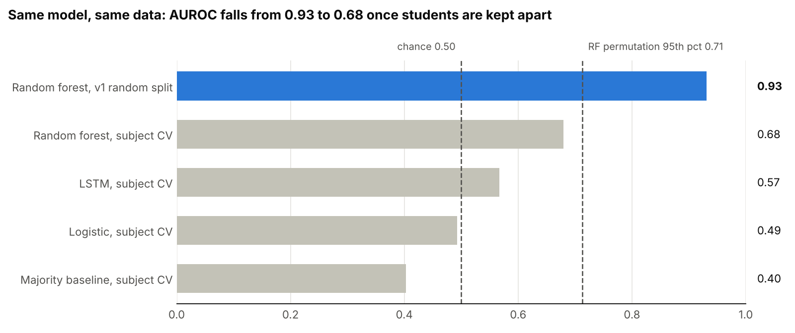
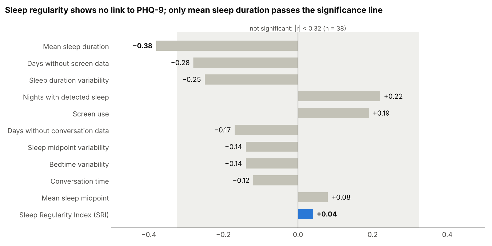

# Sleep Regularity → Depression Risk: a leakage case study

[](https://github.com/chandanamahesh15/sleep-regularity-depression/actions/workflows/ci.yml)

**The original model looked strong (F1 0.82). An audit showed the score came from subject-level data leakage. Once that was fixed, no model predicted depression better than chance, and sleep regularity showed no association with depressive symptoms.**



---

## At a glance

| | v1 (original) | v2 (corrected) |
|---|---|---|
| Evaluation | Random 80/20 split over overlapping 7-day windows | 5×5-fold cross-validation **over students**, scored per student |
| Reported score | Weighted F1 0.78 (RF), 0.82 (LSTM) | AUROC 0.68 (RF), 0.57 (LSTM), 0.49 (logistic) |
| Same random forest, same data | AUROC **0.93** | AUROC **0.68** |
| Better than chance? | Not tested | **No**: best permutation p = 0.097 |
| Sleep regularity (SRI) vs PHQ-9 | Claimed as the key signal | Spearman r = **0.04** |
| Conclusion | "Innovation validated" | No evidence SRI is a digital biomarker in this cohort |

Data: [StudentLife](https://studentlife.cs.dartmouth.edu/dataset.html) (Dartmouth, spring 2013), 38 students with a post-term PHQ-9, 7 with PHQ-9 ≥ 10.

---

## What went wrong in v1

| # | Defect | Effect |
|---|---|---|
| 1 | Random split over windows; student ID discarded | 38 of 38 test students were also in training, so the model recognised people rather than depression |
| 2 | Pre- and post-term PHQ-9 both kept | Every day duplicated (3,607 rows instead of 1,642) |
| 3 | "SRI" was a rolling std of midpoint differences | Not the published index; missing nights produced 48-hour jumps |
| 4 | UTC treated as local time; missing data filled with 0 | Shifted sleep times; "sensor off" read as "no activity" |
| 5 | No validation set, baseline or significance test | Memorisation and chance-level results went undetected |

Full write-up, with all ten defects, how they were found, and the corrected results: **[docs/case_study.md](docs/case_study.md)**.

## Key findings



- **Sleep regularity:** r = 0.04, inside the range expected by chance.
- **Mean sleep duration:** r = −0.38, the only feature past the significance line (shorter sleep, higher PHQ-9), not corrected for multiple comparisons.
- **PHQ-9 ≥ 5 sensitivity check:** AUROC 0.64, p = 0.226, not significant.
- **Limitation:** with 38 students, only correlations of r ≥ 0.44 are reliably detectable. A small real effect can't be ruled out.

---

## Repository layout

```
├── notebooks/
│   ├── sleep_regularity_v1_leakage.ipynb             original analysis, kept unchanged
│   └── sleep_regularity_v2_leakage_corrected.ipynb   corrected analysis (source of all reported numbers)
├── results/notebook_v2/      outputs of the v2 notebook (CSVs + headline_metrics.json)
├── docs/
│   ├── case_study.md         academic write-up
│   ├── NOTEBOOK_AUDIT.md     structural review of the v1 notebook
│   └── figures/              generated by scripts/make_figures.py
├── src/sleeprisk/            production package: same method as the v2 notebook
├── configs/default.yaml      every experiment setting in one place
├── tests/                    unit tests + leakage-guard tests
├── scripts/                  data download, figure generation
└── .github/workflows/ci.yml  lint + tests on every push
```

## How to run

**Option A: notebook (Google Colab).** Open `notebooks/sleep_regularity_v2_leakage_corrected.ipynb` in Colab and choose *Runtime → Run all*. It downloads the data from Kaggle and takes about 10 minutes on CPU.

**Option B: package.**

```bash
git clone https://github.com/chandanamahesh15/sleep-regularity-depression.git
cd sleep-regularity-depression
make install          # pip install -e ".[dev,lstm,data]"
make data             # download StudentLife from Kaggle into data/raw/dataset
make run              # full experiment -> results/runs/report.md
make test             # 21 tests on synthetic data (no download needed)
```

Override any setting from the command line, e.g. the sensitivity analysis:

```bash
sleeprisk run --set labels.threshold=5 --set cv.n_repeats=10
```

The package reproduces the notebook's method. The numbers reported above come from the notebook run; package results can differ slightly because of library versions and random seeds.

## Leakage guards

The checks that would have caught v1's problems now run on every execution and in CI:

- `assert_disjoint_groups`: stops the run if any student appears in both train and test, at every fold
- `validate="one_to_one"` merges plus `assert_unique_keys`: no duplicated days
- `assert_one_label_per_user`: one PHQ-9 label per student
- Imputation and scaling inside scikit-learn pipelines: fitted on training folds only
- `tests/test_leakage_guards.py`: confirms the old random split really leaks and the new one doesn't

## Future work

A pre-registered test on [GLOBEM](https://www.physionet.org/content/globem/) (497 students, Fitbit sleep, weekly PHQ-4, 2018–2021): does SRI add predictive value beyond sleep duration, does irregular sleep precede worse mood within a student, and does the result hold across yearly cohorts? See Section 8 of the [case study](docs/case_study.md).

## Ethics

PHQ-9 is a screening questionnaire, not a diagnosis. StudentLife is a de-identified public research dataset; no attempt was made to re-identify participants. Nothing here is intended for clinical use.

## Data and citation

Wang, R. et al. (2014). *StudentLife: assessing mental health, academic performance and behavioral trends of college students using smartphones.* UbiComp 2014. The raw data is not redistributed in this repo; `make data` downloads it.

## License

Code: MIT (see [LICENSE](LICENSE)). The StudentLife data is subject to its own terms.
