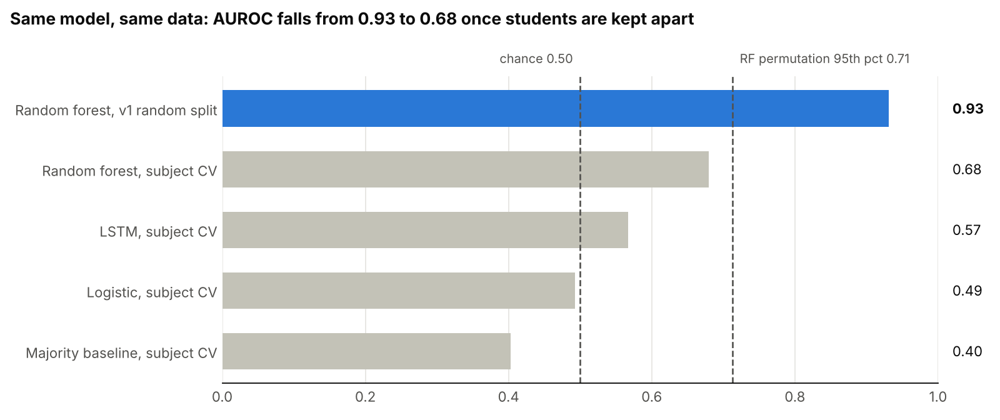
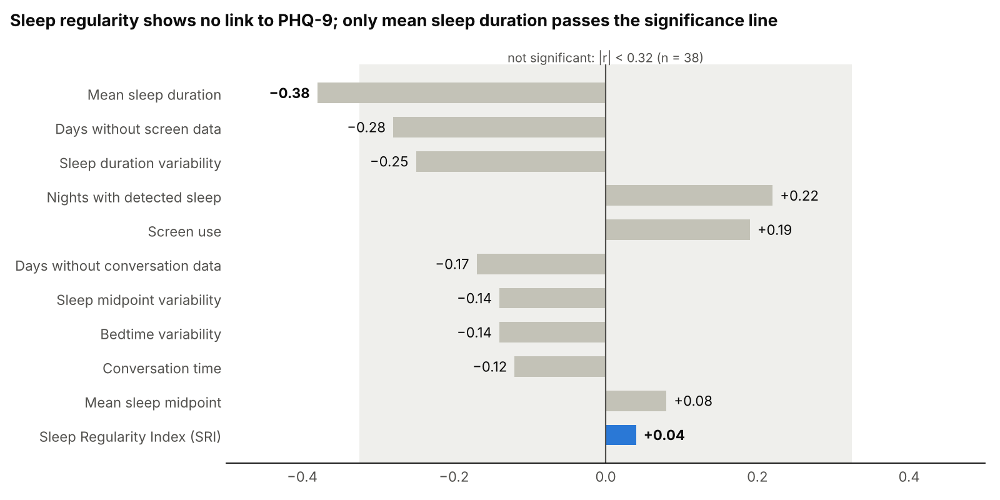

# Sleep Regularity and Depression Risk: A Leakage Case Study

*Chandana Mahesh · October 2026*

## Abstract

The original project reported that phone-derived sleep regularity predicts depression risk in college students, with weighted F1 of 0.78 (random forest) and 0.82 (LSTM). An audit found that these scores came from subject-level data leakage: overlapping 7-day windows from the same student appeared in both training and test sets, so the models learned to recognize individuals rather than depression. Duplicated labels, a time-zone error and a mislabelled regularity metric compounded the problem.

After correcting the pipeline and evaluating with repeated, subject-level cross-validation, the same random forest fell from AUROC 0.93 (leaky split) to 0.68, and no model beat chance at p < 0.05 in label-permutation tests (best: p = 0.097). Sleep regularity showed no association with PHQ-9 scores (Spearman r = 0.04, n = 38); mean sleep duration was the only feature with a notable association (r = −0.38).

The study therefore finds no evidence that sleep regularity is a digital biomarker of depression in this cohort, while noting that 38 students can only detect effects of r ≥ 0.44. A pre-registered test on a larger wearable dataset is proposed.

## 1. Introduction and original hypothesis

The project asked whether irregular sleep, measured passively from a smartphone, can flag college students at risk of depression. If it could, it would be a low-cost digital biomarker: a screening signal collected without questionnaires.

**Hypothesis (v1):** students with less regular sleep timing have higher depressive symptoms, and a model using sleep regularity can classify them.

| Element | Choice in the original project |
| --- | --- |
| Dataset | [StudentLife](https://studentlife.cs.dartmouth.edu/dataset.html), Dartmouth, spring 2013, \~10 weeks, 49 students with sensing data |
| Sleep signal | Phone-lock episodes of 3–14 hours treated as sleep; longest episode per night |
| Claimed innovation | A "Sleep Regularity Index" (SRI) from the variability of nightly sleep midpoints |
| Context features | App usage (screen time) and detected conversation (social time) |
| Label | PHQ-9 total ≥ 5 (mild symptoms or worse) |
| Models | Random forest on window summaries; LSTM on 7-day sequences |

PHQ-9 is a nine-item depression questionnaire scored 0–27. A score of 5 marks mild symptoms and 10 marks moderate symptoms, the usual screening cut-off.

## 2. Original method (v1) and reported results

The v1 notebook reported that both models cleared its 0.70 "success threshold" and concluded "Innovation Validated".

1. Read phone-lock, app-usage and conversation files per student; failures skipped with `except: continue`.
2. Scored PHQ-9 from both the `pre` and `post` surveys; unanswered items scored as 0.
3. Inner-merged daily features with labels on `uid`; filled all missing values with 0.
4. Built 7-day windows by sliding one row at a time (stride 1); student IDs were not kept.
5. Split windows randomly 80/20 with `train_test_split`; trained a random forest and an LSTM (100 epochs, no validation set).

| Metric (v1) | Random forest | LSTM |
| --- | --- | --- |
| Weighted F1 on the random test split | 0.78 | 0.82 |
| Merged table | 3,607 rows, 46 students | same |

The LSTM's 0.04 advantage was presented as evidence that temporal sleep patterns matter.

## 3. How the flaws were discovered

No single error gave the problem away; five warning signs in the notebook's own output pointed to it once read together.

1. **Identical consecutive rows.** The EDA preview showed rows 0/1 and 2/3 of the merged table as exact copies. Tracing them back found two PHQ-9 rows per student (pre and post), so the merge doubled every day. The summary table already hinted at it: 78.4 observed days per student in a 67-day study period.
2. **Implausible regularity values.** The midpoint differences behind the "SRI" jumped to about 48 hours, pushing SRI values to 19–21 hours. Each jump sat on a missing night: the metric differenced raw timestamps, so a skipped day looked like a 48-hour shift in sleep timing.
3. **The written insight contradicted the numbers.** The notebook stated that SRI correlated with risk more strongly than duration, but its own correlation matrix showed SRI–label r = 0.003 against duration–label r = −0.16, and SHAP ranked mean SRI last.
4. **A score too good for the signal.** Features with near-zero correlation to the label could not plausibly support F1 = 0.82. Strong scores with weak features usually mean the model is using something other than the features of interest.
5. **The evaluation design.** Each student contributed dozens of windows that overlap by 6 of 7 days, and the label is constant per student. A random split therefore puts near-copies of each student's windows on both sides, letting the model match a student's behavioural fingerprint to their label.

Sign 5 was confirmed experimentally: re-running the v1 protocol on the corrected data showed that 38 of 38 test students, and 100% of test windows, also appeared in training (Section 6).

## 4. Issues found

The audit found ten defects; the first two invalidate the reported scores on their own.

| # | Defect | Root cause | Effect | Fix (v2) |
| --- | --- | --- | --- | --- |
| 1 | Subject leakage | Random split over windows; student ID discarded | Test scores measure recognition of seen students | Cross-validation folds formed over students |
| 2 | Overlapping windows treated as independent | Stride-1 windows share 6 of 7 days | Test windows are near-copies of training windows | Windows tagged with student ID; scored per student |
| 3 | Duplicated days | Pre and post PHQ-9 kept; inner merge on `uid` | 3,607 rows instead of 1,642; conflicting labels possible | `post` wave only; one label per student; `validate=` on merges |
| 4 | Backwards timing | Pre-term survey labelled term-long behaviour | Label precedes the data it is predicted from | `post` survey, collected at end of term |
| 5 | Missing answers scored 0 | `fillna(0)` on PHQ-9 items | Scores biased low | Drop if > 1 missing; prorate if 1 |
| 6 | Mislabelled "SRI" | Rolling std of midpoint differences | Not the published index; breaks on missing nights | Phillips et al. (2017) SRI on 15-minute epochs |
| 7 | Time zone | UTC treated as local time | Dates and midpoints shifted 4–5 hours | Converted to America/New\_York |
| 8 | Missing treated as zero | `fillna(0)` on sensor features | "Sensor off" read as "no activity" | NaN kept; missingness flags added |
| 9 | Row-based windows | Windows cut by row index | A "7-day" window could span weeks | Windows on a complete calendar |
| 10 | No validation or baseline | Fixed 100 epochs; one split; no trivial model | Memorisation undetected; no reference point | Early stopping on a student-grouped split; majority and logistic baselines; permutation tests |

Silent `except: continue` blocks also hid any file that failed to load; v2 logs every failure.

## 5. Corrected method (v2)

v2 keeps the original question and models but changes the data pipeline and, above all, the unit of evaluation: the student, not the window.

**Data and labels**

- Data: StudentLife via the Kaggle mirror (the Dartmouth server timed out); 49 students with sensing, **38 with a post-term PHQ-9**.
- Label: PHQ-9 ≥ 10 (moderate or worse) → **7 positive, 31 negative**. PHQ-9 ≥ 5 (19 positive) run as a sensitivity analysis.

**Features**

- Sleep: longest 3–14 h lock per noon-to-noon night in local time; duration, clock-time midpoint and onset, on a complete calendar so missing nights stay missing (70% of nights detected).
- Regularity: the published SRI — the share of 15-minute epochs in the same sleep/wake state 24 hours apart, scaled to −100…100, computed only across pairs of observed nights.
- Context: log screen samples and log conversation minutes per local day, with missing-day flags (screen missing 4%, conversation 9%).
- Per student: 11 term-level summaries (means, variability, SRI, data-completeness fractions). Per window: the same summaries over 7 calendar days, plus the daily sequence for the LSTM (1,593 windows, median 46 per student).

**Evaluation**

- Repeated stratified 5-fold cross-validation over students (5 repeats); an assertion stops the run if any student appears in both train and test.
- Window predictions averaged into one probability per student; all metrics computed per student.
- Models: majority-class baseline; logistic regression on student summaries; random forest on window summaries; LSTM with mask channels for missing days, class weighting and early stopping on a student-grouped validation split.
- Imputation and scaling fitted inside each training fold only.
- Significance: label-permutation tests (30–50 shuffles of labels across students, full cross-validation each time).
- Leakage audit: the v1 random-window split re-run on the corrected data to measure the inflation directly.

## 6. Results

Removing the leak cut the random forest's AUROC from 0.93 to 0.68, and no model's corrected score was distinguishable from chance.

### 6.1 Leakage audit

On identical data and features, the v1 random-window split gave the random forest AUROC 0.931 (balanced accuracy 0.833). All 38 test students, and 100% of test windows, also appeared in training. Under subject-level cross-validation the same model scored 0.680.

Only the v1 split clears the permutation threshold; every corrected model sits below it.

### 6.2 Subject-level performance and significance

| Model | Balanced accuracy | Sensitivity | Specificity | Permutation p |
| --- | --- | --- | --- | --- |
| Random forest (windows) | 0.486 | 0.11 | 0.86 | 0.097 |
| LSTM (sequences) | 0.518 | 0.23 | 0.81 | not run |
| Logistic (student summaries) | 0.523 | 0.34 | 0.70 | 0.471 |
| Majority baseline | 0.500 | 0.00 | 1.00 | not applicable |

Means of 5 repeats of 5-fold cross-validation over 38 students (7 positive), threshold 0.5. The random forest ranks students somewhat but catches only 1 in 9 depressed students at the default threshold. The majority baseline's AUROC of 0.40 shows how far chance alone moves this metric with 7 positives.

### 6.3 Which features relate to depression

SRI sits at r = 0.04, inside the band of values expected by chance. Mean sleep duration (r = −0.38) is the only feature outside it.

In the multivariable logistic model, SRI's coefficient was negative (−0.42 ± 0.23 across folds), but the model as a whole did not beat chance (p = 0.47), so individual coefficients cannot be interpreted.

### 6.4 Sensitivity analysis

At PHQ-9 ≥ 5 (19 of 38 positive), logistic regression reached AUROC 0.638, still not significant (p = 0.226; 95th percentile of shuffled runs 0.713). The labels were shuffled at the same threshold, so the null distribution matches the observed score.

## 7. Discussion: is sleep regularity a digital biomarker?

In this cohort there is no evidence that it is — but this study cannot show that it is not.

**Why the original scores were high.** Each student produced about 46 windows with a constant label and a stable behavioural fingerprint (habitual sleep length, bedtime, phone use). With a random split, the model only had to recognise whose window it was. The 0.93 → 0.68 drop measures how much of the original performance was recognition rather than prediction.

| Claim | Supported by this study? |
| --- | --- |
| The original F1 of 0.78–0.82 reflected depression prediction | No: it came from subject leakage |
| Phone-derived SRI is associated with PHQ-9 in StudentLife | No: r = 0.04 |
| Any model predicts depression better than chance here | No: best p = 0.097 |
| Shorter sleep duration goes with higher PHQ-9 | Weak evidence: r = −0.38, the only feature past the significance threshold, untested for multiple comparisons |
| Sleep regularity is not a digital biomarker of depression | Cannot be concluded: the study could only detect r ≥ 0.44 |
| The LSTM's temporal modelling adds value | No: it did not beat simpler models under honest evaluation |

**What the evidence supports.** Sleep regularity, as measured by phone-lock in 38 students, did not separate students with moderate depression from those without. Duration shows a weak trend worth testing in a larger sample. Larger accelerometer studies have linked irregular rest–activity rhythms to mood outcomes, with small effects; an effect of that size would be invisible here.

## 8. Limitations and future work

The main limitation is statistical power: with 38 students and 7 positives, only correlations of about r ≥ 0.44 could be detected reliably (80% power, α = 0.05), while behaviour–mood effects are typically r = 0.1–0.2.

| Limitation | Consequence |
| --- | --- |
| 38 labelled students, 7 positive | Wide uncertainty; AUROC moves about ±0.1 by chance |
| Phone lock as a sleep proxy | 70% of nights detected; some "sleep" began at 7 PM or 10 AM; noise pulls correlations toward zero |
| SRI needs consecutive nights | Each missing night removes a comparison pair |
| One PHQ-9 per student | No way to test whether irregular sleep comes before low mood |
| One campus, spring 2013, \~10 weeks | Results may not generalise to other students or years |
| Several features and two thresholds tested | Duration's r = −0.38 is not corrected for multiple comparisons |

**Ethics.** PHQ-9 is a screening tool, not a diagnosis, and any deployed model would carry risks of false reassurance and stigma. The dataset is de-identified; no attempt was made to re-identify students.

### Future work: a pre-registered test on a larger dataset

[GLOBEM](https://www.physionet.org/content/globem/) fits the question better: 497 students across four yearly cohorts (2018–2021), Fitbit sleep, weekly PHQ-4 and end-of-term BDI-II. Access needs PhysioNet credentialing, CITI training and a data use agreement. [NetHealth](https://sites.nd.edu/nethealth/) (\~700 Notre Dame students, Fitbit, 2015–2019) could serve as replication.

Hypotheses and analysis to be registered before any GLOBEM data is examined:

1. **Association:** lower Fitbit SRI relates to higher BDI-II, adjusted for mean sleep duration.
2. **Added value:** adding SRI to a duration-only model raises held-out AUROC, training on 2018–2019 and testing on 2020–2021.
3. **Precedence:** within a student, lower SRI in week *t* predicts higher PHQ-4 in week *t+1* (mixed-effects model, random intercept per student).
4. **Fixed in advance:** the SRI code from this study, BDI-II > 13, α = 0.05, and reporting of all outcomes.

With 497 students, correlations of about r ≥ 0.13 become detectable.

## 9. Lessons learned

Most of these defects would have been caught by a handful of checks that now run in the v2 code.

- [ ] Split by the unit you want to generalise to (here, students), never by rows derived from them.
- [ ] Treat overlapping windows as one sample per subject when scoring.
- [ ] Assert one label per subject, and use `validate=` on every merge.
- [ ] Keep missing data missing; add flags rather than filling zeros.
- [ ] Convert timestamps to local time before any date logic.
- [ ] Implement published metrics as published, or rename them.
- [ ] Fit imputation and scaling inside each training fold.
- [ ] Report a trivial baseline and a permutation test next to every score.
- [ ] Be suspicious when weak features produce strong scores.
- [ ] Check written conclusions against the numbers that produced them.
- [ ] Size the study for the effect you expect before claiming a null or a finding.

## Reproducibility

| Item | Value |
| --- | --- |
| Code | `sleep_regularity_v2_leakage_corrected.ipynb` (18 cells + permutation cell 15b); original kept as `sleep_regularity_v1_leakage.ipynb` |
| Data | StudentLife via Kaggle `dartweichen/student-life` (390 MB) |
| Environment | Google Colab, pandas 2.2.3, PyTorch 2.11 (CPU) |
| Seeds | 42 for Python, NumPy and PyTorch; CV repeat r uses seed 42 + r |
| Settings | Time zone America/New\_York; PHQ-9 post wave, threshold 10; sleep 3–14 h; 7-day windows with ≥ 4 valid nights |
| Run time | About 5 minutes, plus about 5 minutes per permutation test |

## References

- Wang, R. et al. (2014). StudentLife: assessing mental health, academic performance and behavioral trends of college students using smartphones. *UbiComp 2014*. [Dataset](https://studentlife.cs.dartmouth.edu/dataset.html)
- Phillips, A. J. K. et al. (2017). Irregular sleep/wake patterns are associated with poorer academic performance and delayed circadian and sleep/wake timing. *Scientific Reports*, 7. (Definition of the Sleep Regularity Index.)
- Kroenke, K., Spitzer, R. L., & Williams, J. B. W. (2001). The PHQ-9: validity of a brief depression severity measure. *Journal of General Internal Medicine*, 16(9).
- Saeb, S. et al. (2017). The need to approximate the use-case in clinical machine learning. *GigaScience*, 6(5). (Record-wise vs subject-wise cross-validation.)
- Kaufman, S. et al. (2012). Leakage in data mining: formulation, detection, and avoidance. *ACM Transactions on Knowledge Discovery from Data*, 6(4).
- Ojala, M., & Garriga, G. C. (2010). Permutation tests for studying classifier performance. *Journal of Machine Learning Research*, 11.
- Xu, X. et al. (2022). GLOBEM dataset: multi-year datasets for longitudinal human behavior modeling generalization. *NeurIPS Datasets and Benchmarks*. [arXiv](https://arxiv.org/pdf/2211.02733) · [PhysioNet](https://www.physionet.org/content/globem/)
- NetHealth Project, University of Notre Dame. [Project site](https://sites.nd.edu/nethealth/)
